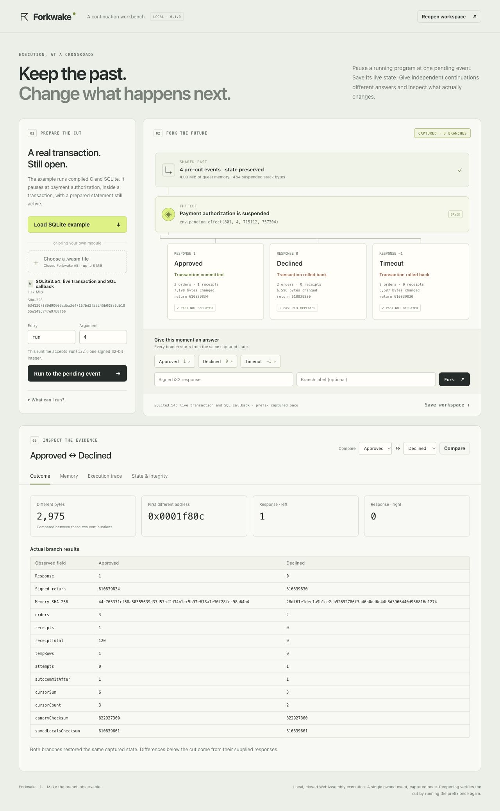

# Forkwake

**Capture a running WebAssembly program at one pending event. Give the saved continuation different answers. Inspect the futures it actually executes.**

Forkwake saves the suspended call stack, linear memory, mutable integer globals and owned event history. Each branch restores that state into an independent guest instance and resumes the pending call. It does not restart the program and feed it different inputs.

The included example pauses **inside SQLite's SQL engine**, during a payment authorization callback. An open transaction, two busy prepared statements, nested C locals, allocated memory and an unfinished SQL expression remain live at the cut. Approval commits a paid order and receipt. Denial and timeout roll back, then record different attempts. These results are read from actual SQLite rows in each branch's final memory.



## Try it

Node.js 20 or newer. No API key, account, native runtime compiler or external service is needed.

```sh
git clone https://github.com/nazeeh111/Forkwake.git
cd Forkwake
npm ci --ignore-scripts
npm start
```

Open the printed loopback address, normally `http://127.0.0.1:6350`. Load the SQLite example, run to the pending event, and choose Approved, Declined or Timeout. Compare database rows, the execution suffix, globals and exact memory differences. You can also enter any signed 32-bit response.

The first capture rewrites the compiled module with Binaryen Asyncify. Later branches reuse the validated transformation and create fresh guest instances. On the development Mac, the 1.17 MiB SQLite module took about 13 seconds to capture and a cached fork about 0.24 seconds. These are example measurements, not a performance guarantee. Every workbench job has a 30-second deadline and can be cancelled.

## Reproducible cuts, outside the browser

```sh
node cli.mjs demo --out ./sqlite-futures
node cli.mjs run --module ./examples/continuation/fixture.raw.wasm \
  --input 4 --responses 1,0,-1 --out ./c-futures
node cli.mjs resume --workspace ./sqlite-futures/workspace.forkwake \
  --responses 2,-2 --out ./more-futures
```

Output directories must be new. `workspace.forkwake` contains the original module, captured state and branch responses. `outcomes.json` records actual results, traces, restoration checks, hashes and memory changes. Add `--memory` to save each branch's final memory as a binary file. Neither export contains the runtime's private authentication key.

Save and reopen a workspace in the interface too. Reopening **independently executes the prefix once to validate the cut**, comparing the recaptured bytes, globals, stack and history. It then executes saved branches again. Reported outcomes and old authentication seals are never accepted as evidence. Subsequent forks resume the validated cut without prefix replay. A browser refresh reads an existing live session from the server without executing the guest; a server restart requires reopening an exported workspace.

Workspaces include the guest's complete memory. Keep them private if the program contains private data. Forkwake has no telemetry, automatic upload or sharing endpoint.

## Bring your own program

This version accepts a **closed wasm32 guest**: a WebAssembly program with one owned memory and an explicitly controlled event boundary. It does not clone native processes, open files, sockets or arbitrary applications. The boundary is small enough to make state restoration explicit and testable.

Required exports:

| Export | Type | Purpose |
| --- | --- | --- |
| `run` | `(i32) -> i32` | Entry point with one signed integer argument |
| `memory` | owned unshared wasm32 memory | Explicit maximum, at most 32 MiB |
| `header_address` | `() -> i32` | Address of reserved Asyncify storage |
| `asyncify_capacity` | `() -> i32` | Reserved storage size including an 8-byte header |

Allowed imports:

| Import | Type | Behavior |
| --- | --- | --- |
| `env.pre_cut` | `(i32, i32) -> void` | Optional opaque prefix event |
| `env.pending_effect` | `(i32, i32, i32, i32) -> i32` | Suspends; each branch supplies its response |
| `env.post_cut` | `(i32, i32) -> void` | Optional opaque suffix event |

Only `pending_effect` is required. Its four arguments are captured as unsigned bit patterns and must match when the stack rewinds. Reaching a second pending event is rejected. Use the included freestanding C example as a complete integration reference; the SQLite example shows a much larger unchanged library running through this boundary. Both include source and build recipes. Building examples requires the free official WASI SDK, not running them. For example, set `WASI_SDK_PATH` to the SDK root and run `sh examples/sqlite/build.sh`. To preserve the supplied binary, set `FORKWAKE_BUILD_OUT` to a new directory ending in `workflow.raw.wasm`. The compiler records the output basename in a WebAssembly name section, so other basenames change its hash even when executable sections are identical.

The two storage accessors must be pure, bounded functions. Forkwake statically checks their complete owned call graph before execution. Constants, locals, global reads and nontrapping scalar arithmetic are supported; memory loads/writes, imports, growth, loops, recursion and other unsupported forms reject. Optional `_initialize()` runs in fresh instances before restoration and cannot call the bridge. A module start function rejects.

Fixed private function tables are supported and reconstructed from the same module in each instance. Imported/exported/mutable tables, shared/imported/multiple memories, memory64, passive segment state and unowned imports reject. Classification is conservative, including unreachable unsupported code. Modules are capped at 8 MiB, Asyncify storage at 1 MiB, event history at 4,096 records. The workbench retains at most four modules, four cuts and twelve branches within a 64 MiB logical data budget; export and restart when full. See [the engine contract](README_engine.md) for exact restoration and authentication details.

## What establishes the result

```sh
npm test
```

Tests compare resumed compiled C and SQLite executions with uninterrupted original-module controls, including both repeated controls and sibling isolation. SQLite comparisons include every exported result word and actual JSON query rows. The suite also checks exact i64 global restoration, memory growth, nested frames, sealed prefix callbacks, portable import revalidation, forged cuts/caches, side-effecting storage accessors, unsupported modules, HTTP write boundaries and cancellation. CLI tests exercise packaged workflows and reject invalid input and overwrite attempts.

The saved SQLite frame is 484 bytes; the complete captured memory is 4 MiB. The fixture separately reports actual SQLite allocation and a 64 KiB allocated canary. These are different measures. Restoration checks and these controls are runtime evidence on the shipped cases, not a proof of every possible Asyncify transformation or application equivalence.

The SQLite guest's file interface is an owned memory-only implementation. External file opening/deletion is denied; its clock and random source are deterministic guest state. No WASI filesystem, network or host-clock capability is supplied. Cancellation prevents unfinished results from being accepted. Run untrusted modules only inside the bounded worker route, never by directly calling the synchronous engine in a long-lived host process.

## Foundation and contribution

Binaryen's [Asyncify](https://kripken.github.io/blog/wasm/2019/07/16/asyncify.html) provides the established stack transformation. Forkwake adds the closed guest contract, authenticated portable cuts, actual sibling restoration, independent import checks and an inspection workflow around it. Execution forking and multiverse debugging have prior art; this project claims no first invention.

Original code is MIT. SQLite source is unchanged public-domain code; Binaryen is Apache-2.0. Official source identities and build provenance are included. See [third-party notices](THIRD_PARTY_NOTICES.md).

Built and tested with Codex. Useful contributions include a public closed guest whose fork disagrees with an uninterrupted control, another reproducible workload, or a specific ABI limitation with a small compiling example. Do not upload proprietary programs or private memory dumps. If this is useful, starring the repository helps other developers find it.
