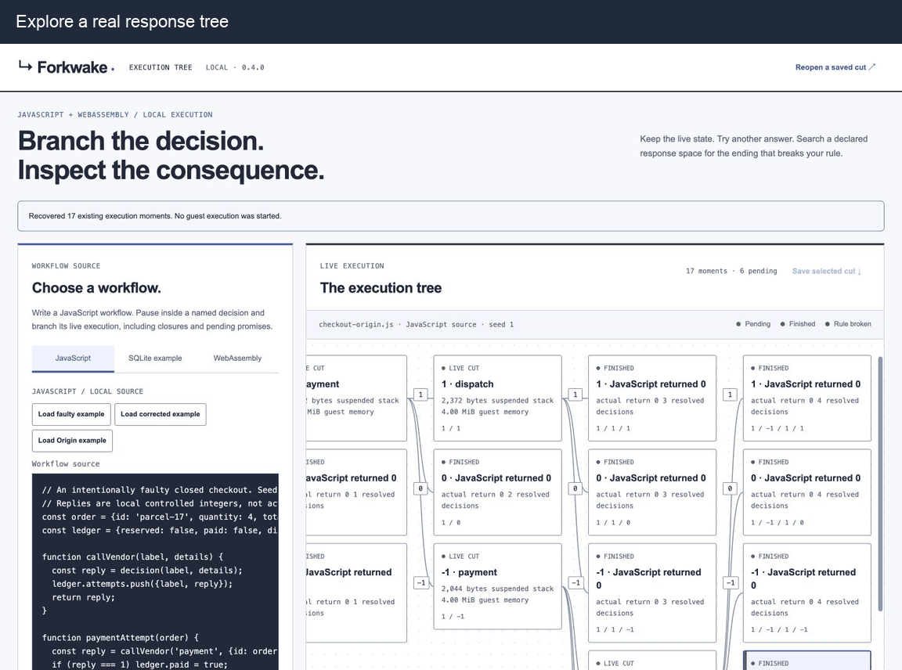

# Forkwake

[](https://github.com/nazeeh111/Forkwake/actions/workflows/test.yml)
[](#run-it)
[](examples/javascript/README.md)
[](docs/origin.md)
[](LICENSE)

**Pause a live program. Branch its next decision. Find the ending that breaks your rule.**

Run JavaScript or a compatible WebAssembly program in a closed local runtime. Forkwake preserves its suspended stack and memory, tries alternative replies, and shows the resulting execution tree. Nothing calls a real payment or shipment service.

<picture>
  <source media="(prefers-reduced-motion: reduce)" srcset="docs/futures-workbench.jpg">
  
</picture>

Actual installed interface, three held views. The authored checkout reaches unpaid dispatch after replies `1, -1, -1, 1`. [Still](docs/futures-workbench.jpg) · [Mobile](docs/futures-mobile-tree.jpg) · [Reproduce the recording](docs/demos/README.md)

## Run it

Node.js 20 or newer. No account, API key or compiler required.

```sh
git clone https://github.com/nazeeh111/Forkwake.git
cd Forkwake
npm ci --ignore-scripts
npm start
```

Open **`/futures`** at the printed address. Capture the loaded JavaScript transfer, search for return `1`, then inspect the named requests and emitted ledger. Two timeout replies expose its deliberately faulty debit policy. Load the corrected example to compare.

For the checkout shown above, select **Load Origin example** before capture. Search with replies `1,0,-1`, baseline `1,1,1,1`, goal `1` and an additional decision limit of `4`. Select the unpaid-dispatch ending and open **Origin** to inspect its recorded callers and captured source. A partial search reports unresolved work; it does not establish the absence of a failure.

## What you can inspect

| Capability | What it gives you |
| --- | --- |
| **Live branches** | Independent continuations of the same suspended stack, memory, globals and owned event history. |
| **Finite search** | Actual response sequences, outputs and declared coverage, ordered by changes from your baseline. |
| **Origin** | Optional JavaScript caller frames mapped to the exact captured source, including after a draft is edited. |
| **Portable cuts** | Save a paused decision, reopen it with an independent replay check, then continue it. |

JavaScript closures, cyclic objects, Map keys and queued Promise jobs survive a branch. The included SQLite workflow pauses inside an open transaction with busy statements. The original single-decision interface remains at **`/`**.

## Bring a workflow

```js
var resultI32;
const account = { balance: 100 };
const reply = decision("Payment", { amount: 25 });
if (reply === 1) account.balance -= 25;
emit(JSON.stringify(account));
resultI32 = account.balance < 0 ? 1 : 0;
```

`decision` suspends for a controlled integer reply. `emit` records the latest output; `resultI32` is the ending searched by the CLI and interface.

```sh
node cli.mjs capture --script ./workflow.js --out ./first-cut
node cli.mjs continue --workspace ./first-cut/workspace.forkwake \
  --responses 1 --out ./approved
node cli.mjs explore --script ./examples/javascript/workflow.js \
  --alphabet 1,0,-1 --baseline 1,1,1,1 --goal 1 --max-depth 4 --out ./transfer-search
```

Output directories must be new. [JavaScript contract](examples/javascript/README.md) · [CLI guide](docs/javascript-cli.md) · [SQLite example](examples/fulfillment/README.md) · [Origin walkthrough](docs/origin.md) · [Timeout witness → regression test](docs/timeout-regression.md)

## Scope and verification

JavaScript runs in a prebuilt QuickJS guest with no Node, browser or network APIs. Custom modules use the documented **closed wasm32 contract**: one owned memory, one integer entry argument and controlled event imports. Forkwake does not clone arbitrary native processes or their files and sockets.

Search admits up to five reply values, 32 decisions and 128 edge attempts per run. A minimum requires all cheaper candidates to be resolved. Origin records callers, not full asynchronous ancestry or causal data flow. The [user guide](docs/USER_GUIDE.md) and [engine contract](README_engine.md) specify quotas, restoration, import checks and unsupported modules.

```sh
npm test
```

Tests compare forked C, SQLite and JavaScript cases with uninterrupted controls, including sibling isolation, portable recovery, search limits and rejected inputs. The owned checkout's 24 finite response paths were compared across ordinary QuickJS, Origin QuickJS and V8; its corrected policy had no unpaid shipment in that set. These are bounded workload checks.

## Foundations and contributing

[Binaryen Asyncify](https://kripken.github.io/blog/wasm/2019/07/16/asyncify.html) supplies the stack transformation. Forkwake adds the closed runtime contract, authenticated portable cuts, restoration checks and inspection workflow. Original code is MIT; [third-party notices](THIRD_PARTY_NOTICES.md) cover Binaryen, QuickJS and SQLite.

Useful contributions: a reproducible disagreement with an uninterrupted control, a compatible workload, or a concrete contract limitation.
