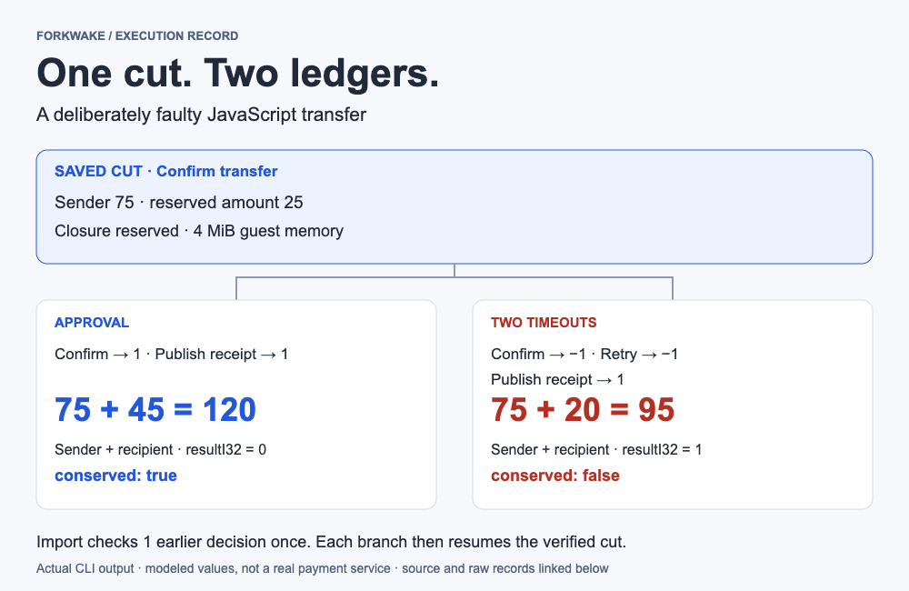

# Forkwake

[](https://github.com/nazeeh111/Forkwake/actions/workflows/test.yml)
[](#run-it)
[](examples/javascript/README.md)
[](docs/origin.md)
[](LICENSE)

**Save a live decision. Reopen it. Follow a different ending.**

Forkwake branches JavaScript and compatible WebAssembly execution inside a closed local runtime. Its portable cuts preserve the suspended stack, memory and globals, so you can inspect how the same program state responds to different replies.

<picture>
  <source media="(max-width: 600px)" srcset="docs/presentation/same-cut-mobile.png">
  
</picture>

The included transfer reserves `25`, then pauses at **Confirm transfer**. Reopening that same cut with replies `1,1` conserves the initial total: `75 + 45 = 120`. Replies `-1,-1,1` expose its deliberately faulty timeout policy: `75 + 20 = 95`, `conserved: false`, return `1`. These are modeled values; no real payment service runs.

[Reproduce both endings](docs/presentation/README.md) · [Actual output and source identity](docs/presentation/paired-outcomes.json) · [Vector figure](docs/presentation/same-cut.svg)

## Run it

Node.js 20 or newer. The first `npm ci` downloads the locked dependency; after installation the examples run locally. No account, API key or compiler is required. Current source is unreleased `0.4.2-dev.0`; the historical 0.4.1 package does not include search checkpoint resume.

```sh
git clone https://github.com/nazeeh111/Forkwake.git
cd Forkwake
npm ci --ignore-scripts
npm start
```

Open **`/futures`** at the printed address. Capture the loaded JavaScript transfer, search for return `1`, then inspect the named requests and emitted ledger. Two timeout replies expose its deliberately faulty debit policy. Load the corrected example to compare.

For the separate checkout example, select **Load Origin example** before capture. Search with replies `1,0,-1`, baseline `1,1,1,1`, goal `1` and an additional decision limit of `4`. Select the unpaid-dispatch ending and open **Origin** to inspect its recorded callers and captured source. A partial search reports unresolved work; it does not establish the absence of a failure.

## The execution tree behind the record

[Inspect the actual workbench capture](docs/presentation/workbench-current.png): six tree moments, both endings, and the selected timeout ledger.

This workbench run reopened the CLI's exported cut, then created both branches in the interface. The workflow carries a closure, a self-referencing account and a Map keyed by that account across this decision, and crosses Promise steps before and after it. The program checks object identity before publishing each ending. A portable import independently reexecutes and verifies the earlier prefix once. Branches after that import resume the verified continuation. These checks cover this owned workflow, not arbitrary host programs.

The separate [checkout walkthrough](docs/demos/README.md) shows Origin's caller frames and an unpaid-dispatch witness. [Animated recording](docs/futures-walkthrough.gif) · [Still](docs/futures-workbench.jpg).

## What you can inspect

| Capability | What it gives you |
| --- | --- |
| **Live branches** | Independent continuations of the same suspended stack, memory, globals and owned event history. |
| **Finite search** | Actual response sequences, outputs and declared coverage, ordered by changes from your baseline. Save and resume an unfinished frontier. |
| **Origin** | Optional JavaScript caller frames mapped to the exact captured source, including after a draft is edited. |
| **Portable cuts** | Save a paused decision, reopen it with an independent replay check, then continue it. |

JavaScript closures, cyclic objects, Map keys and queued Promise jobs survive a branch. The included SQLite workflow pauses inside an open transaction with busy statements. The original single-decision interface remains at **`/`**.

## Bring a workflow

```js
var resultI32;
const account = { balance: 100 };
const reply = decision("Payment", { amount: 25 });
if (reply === 1) account.balance -= 25;
emit(JSON.stringify(account));
resultI32 = account.balance < 0 ? 1 : 0;
```

`decision` suspends for a controlled integer reply. `emit` records the latest output; `resultI32` is the ending searched by the CLI and interface.

```sh
node cli.mjs capture --script ./examples/javascript/workflow.js --out ./first-cut
node cli.mjs continue --workspace ./first-cut/workspace.forkwake \
  --responses 1 --out ./approved
node cli.mjs explore --script ./examples/javascript/workflow.js \
  --alphabet 1,0,-1 --baseline 1,1,1,1 --goal 1 --max-depth 4 --max-jobs 1 --out ./transfer-search
node cli.mjs explore-resume --checkpoint ./transfer-search/search.forkwake \
  --max-jobs 128 --out ./continued-search
```

Capture saves a paused decision, while explore runs a bounded search and writes `search.forkwake`. Resume continues that same source-bound frontier into a new directory. Restart independently validates earlier nodes: up to 64 validation jobs are separate from the new edge-attempt budget, so `--max-jobs` does not bound total time. Failed or depth-limited work remains unresolved and can prevent a minimum or exhaustion claim. Checkpoint checksums detect corruption, not authorship; files contain source and guest data, so keep sensitive checkpoints private. [Checkpoint contract](docs/sequence-cli.md#pause-the-search-then-resume-its-frontier).

Output directories must be new. [JavaScript contract](examples/javascript/README.md) · [CLI guide](docs/javascript-cli.md) · [SQLite example](examples/fulfillment/README.md) · [Origin walkthrough](docs/origin.md) · [Timeout witness → regression test](docs/timeout-regression.md)

## Scope and verification

JavaScript runs in a prebuilt QuickJS guest with no Node, browser or network APIs. Custom modules use the documented **closed wasm32 contract**: one owned memory, one integer entry argument and controlled event imports. Forkwake does not clone arbitrary native processes or their files and sockets.

Search admits up to five reply values, 32 decisions and 128 edge attempts per run. A minimum requires all cheaper candidates to be resolved. Origin records callers, not full asynchronous ancestry or causal data flow. The [user guide](docs/USER_GUIDE.md) and [engine contract](README_engine.md) specify quotas, restoration, import checks and unsupported modules.

```sh
npm test
```

Tests compare forked C, SQLite and JavaScript cases with uninterrupted controls, including sibling isolation, portable recovery, search limits and rejected inputs. The owned checkout's 24 finite response paths were compared across ordinary QuickJS, Origin QuickJS and V8; its corrected policy had no unpaid shipment in that set. These are bounded workload checks.

<a id="foundations-and-contributing"></a>

## License and contributing

Original code is MIT; component licenses remain beside the bundled files under `examples/`.

Useful contributions: a reproducible disagreement with an uninterrupted control, a compatible workload, or a concrete contract limitation.
